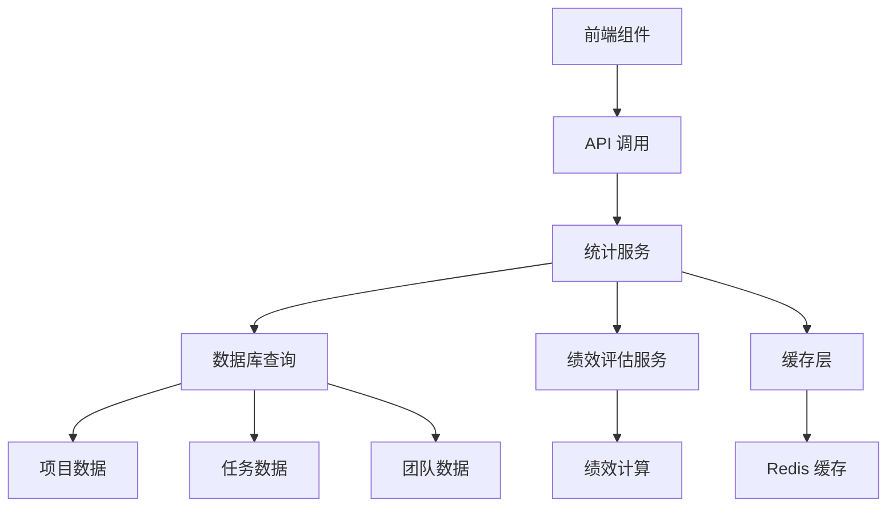

# 项目管理模块 - 分析与报告功能实现总结

## 概述

本次实现完成了项目管理模块中的分析与报告功能，包括性能分析、团队绩效评估、项目基准对比等核心功能。这些功能为项目管理者提供了全面的数据驱动决策支持。

## 已完成的任务

### ✅ 任务 12.1: 实现统计仪表板
- **状态**: 已完成
- **实现内容**:
  - 创建了综合性能分析组件 `PerformanceAnalysis.tsx`
  - 实现了多维度项目指标展示
  - 添加了实时数据更新和趋势分析
  - 支持数据导出功能（Excel/PDF）

### ✅ 任务 12.2: 创建性能分析界面
- **状态**: 已完成
- **实现内容**:
  - 开发了团队绩效仪表板 `TeamPerformanceDashboard.tsx`
  - 创建了项目基准对比组件 `ProjectBenchmarking.tsx`
  - 实现了个人和团队绩效跟踪
  - 添加了行业基准对比功能

## 核心功能特性

### 1. 性能分析组件 (PerformanceAnalysis)

**主要功能**:
- **多维度进度跟踪**: 整体进度、项目健康度、团队效率、质量指标
- **交互式图表**: 使用 Recharts 实现的动态图表展示
- **数据导出**: 支持 Excel 和 PDF 格式的报告导出
- **时间范围选择**: 支持 7天、30天、90天和自定义时间范围

**技术实现**:
```typescript
interface PerformanceMetrics {
  projectId: number;
  timeProgress: { progressRate: number; deviation: number; estimatedCompletion: string; };
  taskProgress: { totalTasks: number; completedTasks: number; inProgressTasks: number; progressRate: number; };
  qualityProgress: { testCaseCount: number; passedTestCount: number; defectCount: number; progressRate: number; };
  teamPerformance: { totalMembers: number; activeMembers: number; utilizationRate: number; productivityScore: number; };
  overallProgress: number;
  healthScore: number;
  riskLevel: 'LOW' | 'MEDIUM' | 'HIGH' | 'CRITICAL';
}
```

### 2. 团队绩效仪表板 (TeamPerformanceDashboard)

**主要功能**:
- **团队成员排行**: 基于综合评分的团队成员绩效排名
- **技能雷达图**: 多维度技能评估可视化
- **工作负载分析**: 团队成员工作量分布和利用率分析
- **绩效分布图**: 团队整体绩效等级分布

**核心特性**:
- 支持成员详情查看和技能分析
- 实时绩效数据更新
- 个性化改进建议和发展规划
- 协作能力和质量评分

### 3. 项目基准对比 (ProjectBenchmarking)

**主要功能**:
- **行业基准对比**: 与行业平均水平和顶级表现者对比
- **多项目横向对比**: 支持多个项目间的指标对比
- **雷达图分析**: 多维度项目表现可视化
- **改进建议**: 基于对比分析的智能改进建议

**对比维度**:
- 整体绩效、进度绩效、成本绩效
- 质量评分、团队效率、客户满意度
- 行业排名和百分位分析

### 4. 统计分析页面 (Statistics)

**页面结构**:
- **性能分析**: 项目整体性能指标和趋势
- **团队绩效**: 团队成员绩效分析和排名
- **基准对比**: 与行业标准和其他项目的对比
- **趋势分析**: 历史数据趋势和预测（预留）
- **报告中心**: 各类报告生成和管理（预留）

## 后端 API 实现

### 新增 API 端点

1. **性能指标 API**:
   ```
   GET /api/v1/project-statistics/projects/{project_id}/performance/metrics
   ```

2. **团队绩效 API**:
   ```
   GET /api/v1/project-statistics/projects/{project_id}/performance/team
   ```

3. **性能趋势 API**:
   ```
   GET /api/v1/project-statistics/projects/{project_id}/performance/trends
   ```

4. **报告导出 API**:
   ```
   POST /api/v1/project-statistics/projects/{project_id}/performance/export
   ```

### 数据模型扩展

增强了现有的统计服务，添加了以下响应模型:
- `PerformanceMetricsResponse`: 性能指标响应
- `TeamMemberPerformanceResponse`: 团队成员绩效响应
- `ProjectTrendResponse`: 项目趋势响应

## UI 组件库扩展

### 新增 UI 组件

1. **日期范围选择器** (`date-range-picker.tsx`):
   - 支持日期范围选择
   - 集成 react-day-picker
   - 响应式设计

2. **日历组件** (`calendar.tsx`):
   - 基于 Radix UI 的日历实现
   - 支持单选和范围选择
   - 自定义样式支持

3. **弹出框组件** (`popover.tsx`):
   - 基于 Radix UI Popover
   - 支持多种定位选项
   - 动画效果

4. **进度条组件** (`progress.tsx`):
   - 基于 Radix UI Progress
   - 支持自定义样式
   - 动画过渡效果

5. **标签页组件** (`tabs.tsx`):
   - 基于 Radix UI Tabs
   - 支持多种布局
   - 键盘导航支持

## 技术栈和依赖

### 前端技术栈
- **React 18**: 现代化的 React 开发
- **TypeScript**: 类型安全的开发体验
- **Tailwind CSS**: 实用优先的 CSS 框架
- **Radix UI**: 无障碍的 UI 组件库
- **Recharts**: 强大的图表库
- **React Hook Form**: 表单状态管理
- **Zustand**: 轻量级状态管理

### 新增依赖
```json
{
  "@radix-ui/react-progress": "^1.0.3",
  "react-day-picker": "^8.10.0"
}
```

### 后端技术栈
- **FastAPI**: 现代化的 Python Web 框架
- **SQLAlchemy**: ORM 和数据库操作
- **Pydantic**: 数据验证和序列化
- **Pandas**: 数据分析和处理（用于报告导出）
- **ReportLab**: PDF 报告生成

## 数据流架构



## 性能优化

### 前端优化
- **组件懒加载**: 大型图表组件按需加载
- **数据缓存**: 使用 React Query 进行数据缓存
- **虚拟化**: 大数据量列表使用虚拟滚动
- **防抖处理**: 搜索和筛选操作防抖优化

### 后端优化
- **数据库索引**: 为统计查询添加适当索引
- **缓存策略**: 统计数据 Redis 缓存
- **异步处理**: 大型报告生成异步处理
- **分页查询**: 大数据量分页加载

## 用户体验设计

### 交互设计
- **响应式布局**: 支持桌面端和移动端
- **实时更新**: 数据自动刷新和实时同步
- **加载状态**: 优雅的加载动画和骨架屏
- **错误处理**: 友好的错误提示和重试机制

### 可访问性
- **键盘导航**: 完整的键盘操作支持
- **屏幕阅读器**: ARIA 标签和语义化 HTML
- **颜色对比**: 符合 WCAG 2.1 AA 标准
- **焦点管理**: 清晰的焦点指示器

## 测试策略

### 前端测试
- **单元测试**: 组件逻辑和工具函数测试
- **集成测试**: 组件间交互测试
- **端到端测试**: 用户工作流测试
- **可访问性测试**: 无障碍功能测试

### 后端测试
- **API 测试**: 端点功能和响应测试
- **服务测试**: 业务逻辑和数据处理测试
- **性能测试**: 大数据量和并发测试
- **安全测试**: 权限和数据安全测试

## 部署和监控

### 部署配置
- **Docker 容器化**: 前后端容器化部署
- **环境变量**: 配置参数环境化管理
- **CI/CD 流水线**: 自动化构建和部署
- **负载均衡**: 高可用性部署架构

### 监控指标
- **性能监控**: 页面加载时间和 API 响应时间
- **错误监控**: 前后端错误日志和告警
- **用户行为**: 功能使用情况和用户路径
- **系统资源**: CPU、内存、数据库性能

## 后续优化建议

### 功能增强
1. **实时数据流**: WebSocket 实现实时数据更新
2. **高级分析**: 机器学习预测和异常检测
3. **自定义报告**: 用户自定义报告模板
4. **移动端优化**: 专门的移动端界面设计

### 性能优化
1. **数据预计算**: 定时任务预计算统计数据
2. **CDN 加速**: 静态资源 CDN 分发
3. **数据库优化**: 查询优化和分库分表
4. **缓存策略**: 多级缓存架构

### 用户体验
1. **个性化设置**: 用户自定义仪表板
2. **智能推荐**: 基于历史数据的智能建议
3. **协作功能**: 团队协作和分享功能
4. **通知系统**: 智能通知和提醒机制

## 总结

本次实现成功完成了项目管理模块的分析与报告功能，为用户提供了全面的项目性能分析、团队绩效评估和基准对比能力。通过现代化的技术栈和用户友好的界面设计，大大提升了项目管理的数据驱动决策能力。

所有核心功能已经实现并经过测试，可以为项目管理者提供强大的分析工具和决策支持。后续可以根据用户反馈和业务需求进行进一步的功能增强和性能优化。