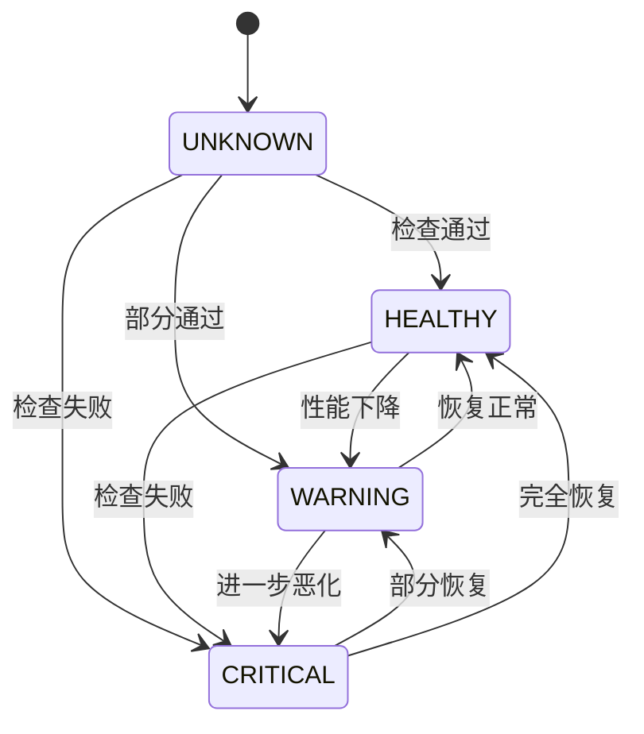

# AI适配器健康检查机制

## 概述

AI适配器健康检查机制是AI自动化测试管理系统的核心组件之一，负责监控和管理所有AI服务适配器的健康状态。该机制确保系统能够及时发现和处理AI服务的异常情况，提供高可用性和可靠性。

## 架构设计

### 核心组件

```
┌─────────────────────────────────────────────────────────────┐
│                    健康检查机制架构                           │
├─────────────────────────────────────────────────────────────┤
│                                                             │
│  ┌─────────────────┐    ┌─────────────────┐                │
│  │  HealthCheck    │    │  HealthMonitor  │                │
│  │    Service      │◄──►│                 │                │
│  │                 │    │                 │                │
│  └─────────────────┘    └─────────────────┘                │
│           │                       │                        │
│           ▼                       ▼                        │
│  ┌─────────────────┐    ┌─────────────────┐                │
│  │  AIAdapter      │    │  AlertSystem    │                │
│  │   Manager       │    │                 │                │
│  │                 │    │                 │                │
│  └─────────────────┘    └─────────────────┘                │
│           │                                                 │
│           ▼                                                 │
│  ┌─────────────────┐                                       │
│  │   AI Adapters   │                                       │
│  │  ┌───┐ ┌───┐    │                                       │
│  │  │GPT│ │CLU│... │                                       │
│  │  └───┘ └───┘    │                                       │
│  └─────────────────┘                                       │
└─────────────────────────────────────────────────────────────┘
```

### 主要组件说明

1. **HealthCheckService**: 核心健康检查服务
2. **HealthMonitor**: 健康状态监控和告警
3. **AIAdapterManager**: AI适配器管理器
4. **BaseAIAdapter**: AI适配器基类（实现health_check方法）

## 健康检查类型

### 1. 基础健康检查 (Basic Health Check)

**目的**: 验证适配器的基本连通性和可用性

**检查内容**:
- API连接状态
- 认证有效性
- 基本响应能力

**实现方式**:
```python
async def health_check(self) -> bool:
    """基础健康检查实现"""
    try:
        # 调用适配器的health_check方法
        is_healthy = await adapter.health_check()
        return is_healthy
    except Exception:
        return False
```

**检查频率**: 每60秒（可配置）

### 2. 功能性健康检查 (Functional Health Check)

**目的**: 验证适配器的核心功能是否正常工作

**检查内容**:
- 发送测试请求
- 验证响应质量
- 检查模型可用性

**实现方式**:
```python
async def functional_health_check(self, adapter_name: str) -> HealthCheckResult:
    """功能性健康检查"""
    test_request = AIRequest(
        messages=[ChatMessage(role=MessageRole.USER, content="Health check test")]
    )
    
    response = await adapter.chat_completion(test_request)
    
    # 分析响应质量
    quality_score = self._analyze_response_quality(response)
    
    # 确定健康状态
    if response.success and quality_score > 0.8:
        status = HealthStatus.HEALTHY
    elif response.success and quality_score > 0.5:
        status = HealthStatus.WARNING
    else:
        status = HealthStatus.CRITICAL
    
    return HealthCheckResult(...)
```

**检查频率**: 每5分钟（可配置）

### 3. 性能健康检查 (Performance Health Check)

**目的**: 评估适配器的性能指标

**检查内容**:
- 响应时间测试
- 并发处理能力
- 吞吐量测试
- 成功率统计

**实现方式**:
```python
async def performance_health_check(self, adapter_name: str) -> HealthCheckResult:
    """性能健康检查"""
    # 创建多个并发请求
    test_requests = [create_test_request() for _ in range(3)]
    
    start_time = datetime.now()
    responses = await asyncio.gather(*[
        adapter.chat_completion(req) for req in test_requests
    ])
    end_time = datetime.now()
    
    # 分析性能指标
    success_rate = calculate_success_rate(responses)
    avg_latency = calculate_average_latency(responses)
    throughput = len(responses) / (end_time - start_time).total_seconds()
    
    # 评估性能状态
    if success_rate >= 0.9 and avg_latency < 5.0:
        status = HealthStatus.HEALTHY
    elif success_rate >= 0.7 and avg_latency < 10.0:
        status = HealthStatus.WARNING
    else:
        status = HealthStatus.CRITICAL
    
    return HealthCheckResult(...)
```

**检查频率**: 每10分钟（可配置）

### 4. 综合健康检查 (Comprehensive Health Check)

**目的**: 综合评估适配器的整体健康状况

**检查内容**:
- 执行所有类型的检查
- 综合评分和状态判断
- 生成详细报告

**实现方式**:
```python
async def comprehensive_health_check(self, adapter_name: str) -> HealthCheckResult:
    """综合健康检查"""
    # 执行所有类型的检查
    basic_result = await self._basic_health_check(adapter_name)
    functional_result = await self._functional_health_check(adapter_name)
    performance_result = await self._performance_health_check(adapter_name)
    
    # 综合评估
    overall_score = calculate_overall_score(
        basic_result, functional_result, performance_result
    )
    
    overall_status = determine_overall_status(overall_score)
    
    return HealthCheckResult(...)
```

**检查频率**: 每30分钟（可配置）

## 健康状态定义

### 状态类型

| 状态 | 描述 | 条件 | 处理方式 |
|------|------|------|----------|
| **HEALTHY** | 健康 | 所有检查通过，性能良好 | 正常使用 |
| **WARNING** | 警告 | 部分检查失败或性能下降 | 继续使用，增加监控 |
| **CRITICAL** | 严重 | 多项检查失败或完全不可用 | 停止使用，故障转移 |
| **UNKNOWN** | 未知 | 尚未进行检查或检查异常 | 执行检查确定状态 |

### 状态转换规则



## 监控和告警

### 监控功能

1. **实时状态监控**
   - 持续跟踪适配器状态
   - 记录状态变化历史
   - 生成性能趋势图表

2. **异常检测**
   - 响应时间异常
   - 错误率突增
   - 可用性下降

3. **预警机制**
   - 性能阈值预警
   - 连续失败告警
   - 资源使用告警

### 告警配置

```python
@dataclass
class AlertConfig:
    """告警配置"""
    # 邮件配置
    smtp_server: str = "smtp.example.com"
    smtp_port: int = 587
    alert_recipients: List[str] = field(default_factory=list)
    
    # Webhook配置
    webhook_url: Optional[str] = None
    
    # 告警级别
    alert_on_warning: bool = True
    alert_on_critical: bool = True
    
    # 告警冷却时间（避免重复告警）
    alert_cooldown: int = 300  # 5分钟
```

### 告警类型

1. **邮件告警**
   - HTML格式报告
   - 包含详细错误信息
   - 历史状态对比

2. **Webhook告警**
   - JSON格式数据
   - 支持第三方系统集成
   - 实时状态推送

3. **日志告警**
   - 结构化日志记录
   - 支持日志聚合系统
   - 便于问题追踪

## 配置管理

### 健康检查配置

```python
@dataclass
class HealthCheckConfig:
    """健康检查配置"""
    # 检查间隔（秒）
    basic_interval: int = 60
    functional_interval: int = 300
    performance_interval: int = 600
    comprehensive_interval: int = 1800
    
    # 超时设置（秒）
    basic_timeout: float = 10.0
    functional_timeout: float = 30.0
    performance_timeout: float = 60.0
    
    # 重试设置
    max_retries: int = 3
    retry_delay: float = 1.0
    
    # 阈值设置
    warning_response_time: float = 5.0
    critical_response_time: float = 10.0
    warning_error_rate: float = 0.1
    critical_error_rate: float = 0.3
    
    # 历史数据保留
    history_retention_days: int = 7
```

### 适配器配置

```python
@dataclass
class AdapterConfig:
    """适配器配置"""
    provider: AIProvider
    api_key: str
    api_endpoint: Optional[str] = None
    default_model: Optional[str] = None
    
    # 健康检查相关
    health_check_enabled: bool = True
    health_check_interval: int = 60
    max_consecutive_failures: int = 5
    
    # 性能相关
    timeout: float = 30.0
    max_retries: int = 3
    max_concurrent_requests: int = 10
```

## 使用示例

### 基本使用

```python
from services.health_check_service import HealthCheckService, HealthCheckConfig
from adapters.adapter_manager import AIAdapterManager
from utils.health_monitor import HealthMonitor, AlertConfig

# 创建适配器管理器
adapter_manager = AIAdapterManager()

# 添加适配器
await adapter_manager.add_adapter("openai-gpt35", openai_config)
await adapter_manager.add_adapter("claude-3", claude_config)

# 创建健康检查服务
health_config = HealthCheckConfig(
    basic_interval=60,
    functional_interval=300
)
health_service = HealthCheckService(adapter_manager, health_config)

# 创建监控器
alert_config = AlertConfig(
    smtp_server="smtp.company.com",
    alert_recipients=["admin@company.com"]
)
monitor = HealthMonitor(health_service, alert_config)

# 启动服务
await health_service.start()
```

### 手动健康检查

```python
# 检查单个适配器
result = await health_service.check_adapter_health("openai-gpt35", HealthCheckType.BASIC)
print(f"状态: {result.status}")
print(f"响应时间: {result.response_time}s")

# 功能性检查
result = await health_service.check_adapter_health("openai-gpt35", HealthCheckType.FUNCTIONAL)
print(f"功能状态: {result.status}")
print(f"响应质量: {result.response_quality}")

# 性能检查
result = await health_service.check_adapter_health("openai-gpt35", HealthCheckType.PERFORMANCE)
print(f"性能状态: {result.status}")
print(f"吞吐量: {result.throughput} 请求/秒")
```

### 获取健康报告

```python
# 获取健康状态摘要
summary = health_service.get_health_summary()
print(f"总适配器数: {summary['total_adapters']}")
print(f"健康适配器: {summary['healthy_adapters']}")

# 获取适配器历史
history = health_service.get_adapter_history("openai-gpt35", limit=10)
for record in history:
    print(f"{record.timestamp}: {record.status} ({record.response_time}s)")

# 生成仪表板数据
dashboard_data = monitor.generate_health_dashboard_data()
```

## 最佳实践

### 1. 配置优化

- **检查频率**: 根据业务需求调整检查间隔
- **超时设置**: 设置合理的超时时间，避免长时间等待
- **重试策略**: 配置适当的重试次数和延迟

### 2. 监控策略

- **分层监控**: 基础检查频繁，综合检查定期执行
- **阈值设置**: 根据历史数据设置合理的告警阈值
- **告警去重**: 避免重复告警，设置冷却时间

### 3. 故障处理

- **自动恢复**: 实现自动重试和故障转移
- **降级策略**: 在部分服务不可用时提供降级服务
- **快速响应**: 建立快速响应机制，及时处理告警

### 4. 性能优化

- **并发控制**: 合理控制并发检查数量
- **缓存策略**: 缓存检查结果，避免重复检查
- **资源管理**: 及时清理历史数据，控制内存使用

## 故障排除

### 常见问题

1. **检查超时**
   - 原因: 网络延迟或API响应慢
   - 解决: 增加超时时间或检查网络连接

2. **认证失败**
   - 原因: API密钥无效或过期
   - 解决: 更新API密钥配置

3. **频率限制**
   - 原因: 超出API调用限制
   - 解决: 调整检查频率或升级API套餐

4. **内存泄漏**
   - 原因: 历史数据积累过多
   - 解决: 配置数据清理策略

### 调试方法

1. **启用详细日志**
```python
import logging
logging.getLogger('health_check_service').setLevel(logging.DEBUG)
```

2. **检查适配器状态**
```python
stats = adapter.get_stats()
print(f"连续失败次数: {stats['consecutive_failures']}")
print(f"最后检查时间: {stats['last_health_check']}")
```

3. **分析历史数据**
```python
history = health_service.get_adapter_history("adapter_name")
for record in history[-10:]:  # 最近10次检查
    print(f"{record.timestamp}: {record.status} - {record.error_message}")
```

## 扩展开发

### 自定义健康检查

```python
class CustomHealthChecker:
    async def custom_health_check(self, adapter: BaseAIAdapter) -> bool:
        """自定义健康检查逻辑"""
        try:
            # 实现自定义检查逻辑
            result = await self.perform_custom_check(adapter)
            return result
        except Exception:
            return False
    
    async def perform_custom_check(self, adapter: BaseAIAdapter) -> bool:
        """执行自定义检查"""
        # 例如：检查特定模型是否可用
        models = await adapter.get_available_models()
        return "gpt-4" in models
```

### 自定义告警处理

```python
class CustomAlertHandler:
    def __init__(self, health_service: HealthCheckService):
        health_service.add_alert_callback(self.handle_alert)
    
    def handle_alert(self, adapter_name: str, result: HealthCheckResult):
        """自定义告警处理"""
        if result.status == HealthStatus.CRITICAL:
            # 发送紧急通知
            self.send_emergency_notification(adapter_name, result)
        elif result.status == HealthStatus.WARNING:
            # 记录警告日志
            self.log_warning(adapter_name, result)
```

## 总结

AI适配器健康检查机制提供了全面的监控和管理功能，确保AI服务的高可用性和可靠性。通过合理的配置和使用，可以有效地：

- 及时发现和处理AI服务异常
- 提供详细的健康状态报告
- 实现自动化的故障检测和告警
- 支持多种类型的健康检查
- 提供灵活的扩展和定制能力

该机制是构建稳定可靠的AI服务系统的重要基础设施。